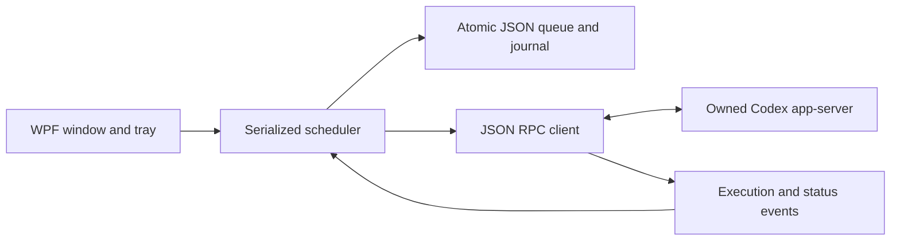

# Integration findings and architecture

Investigated 2026-10-14 against installed **codex-cli 0.159.2** on Linux. Windows Codex Desktop is not installed on this host.

Follow-up on 2026-10-15: the original Desktop UUID requirement is an explicit feasibility gate. Existing local-thread support does not establish access to the user's Desktop sessions. See [the target-Windows no-prompt continuity diagnostic](DESKTOP-FEASIBILITY.md). Its success verifies identity and API-visible recorded history for the supplied UUIDs; it does not supply a Desktop execution lease or UI synchronization. No replacement-session fallback is implemented.

## Evidence inspected before implementation

- `codex --version` reported `codex-cli 0.159.2`.
- `codex app-server --help` documents newline-delimited stdio, WebSocket and Unix transports, plus schema generation. `codex app-server daemon --help` documents managed-daemon commands. Neither establishes a Desktop-owned Windows endpoint that a third-party client can safely attach to.
- `codex app-server generate-json-schema --out <temporary-directory>` generated the installed build's non-experimental schemas. This is the primary wire-format evidence. Required requests: `initialize`, `thread/list`, `thread/read`, `thread/turns/list`, `thread/resume`, `turn/start`, `account/rateLimits/read`. Notifications: `turn/started`, `turn/completed`, `thread/status/changed`, `error`, `account/rateLimits/updated`. Incoming server requests are denied or rejected.
- `ThreadStatus` is a tagged object: `notLoaded`, `idle`, `active` (including `waitingOnApproval` / `waitingOnUserInput` flags), or `systemError`. Turns distinguish `inProgress`, `completed`, `interrupted`, `failed`. Terminal errors include structured `usageLimitExceeded` and `rateLimitExceeded`. Object error variants may carry HTTP 429.
- Rate windows use Unix-second `resetsAt`, primary/secondary percentages and optional multiple buckets. The generated `ordinaryUsageAllowed` description says null means unavailable and clients must not infer recovery from percentages or reset times. AutoResume requires affirmative permission and no exhausted windows. Reset credits never grant permission.
- Generated `TurnStartParams` describes `turn/start` steering an already-active turn. There is no expected-idle revision or global session lease. `clientUserMessageId` exists, but no exactly-once/idempotency contract was established.
- `thread/resume` returns a thread UUID, validated against the request. `turn/start` returns only a turn; AutoResume does not invent a returned thread UUID. Notifications carry thread and turn identities.
- A read-only real-process check successfully initialized app-server and paginated discovery. This host returned zero sessions. That does not validate Desktop history, authenticated resumptions or actual rate-limit resets.

Official references: [OpenAI Codex source](https://github.com/openai/codex/tree/main/codex-rs/app-server), [app-server documentation](https://developers.openai.com/codex/app-server). The developer documentation endpoint returned HTTP 403 here; generated local schemas, executable help and the process check supplied the implementation evidence. Online main-branch documentation may differ from the installed release. Use `scripts/verify-codex.ps1` on the exact Windows executable when checking compatibility.

## Supported scope and limitations

No public integration was verified here for attaching to, coordinating with, or refreshing the standalone Desktop UI. A UUID and shared history do not prove active Desktop continuity. Desktop may use another home, account, machine, workspace or backend. Only sessions successfully read and resumed by the chosen app-server are eligible.

A separate server cannot reliably observe work owned by another process. Even clients sharing an endpoint could race between a read and `turn/start`, which can steer live work. Automatic execution therefore requires explicit **exclusive ownership**: Desktop and other clients remain closed while AutoResume owns selected sessions. Process-name detection is an extra guard, not a global lock. There is no screen scraping, simulated input, private database mutation, `--last`, CLI/exec text scraping or invented Desktop endpoint. If direct Desktop control is mandatory, leave execution disabled until a documented coordination/lease API exists.

Protocol fields vary by version. Missing methods, unknown states, identity/workspace changes and unavailable ordinary-usage permission block affected work. Automatic crash recovery and zero duplicate delivery cannot both be guaranteed after a lost dispatch acknowledgement; the utility requires inspection rather than replaying uncertain requests.

## Architecture

Three projects with no third-party runtime packages:

**Core** owns queue policy, independent conversation state, reconciliation, conflict checks, durable attempts and transport. One asynchronous gate serializes commands, notifications and polling. A separate transport reader completes RPC responses; eligible model turns execute concurrently inside Codex.

**Windows** owns presentation, per-login-session instance mutex, tray, notifications and optional HKCU startup registration. It cannot dispatch turns directly. The UI consumes copied state; clock updates do not poll Codex or rebuild animated cards.

**Tests** use deterministic time, fake execution, real atomic-file persistence and a subprocess wire-protocol fixture. They do not consume model credits.

Each conversation tracks armed/paused/attention flags, live execution, latest turn, timestamps, reset estimate, retry boundary and attempt ID. Global OFF stops future dispatch only. Completion disarms the conversation. Intervention latches attention even if a denied turn later completes. An active paused conversation stays Running until execution stops.

The sequential lane permits one non-starred conversation. Starred work may run alongside it and other starred sessions, with at most five selected sessions total. Common Git directory and nested-workspace checks block conflicting work. Shared worktrees are conservatively serialized; the utility never creates worktrees or moves a conversation's workspace. Symlink/junction paths are rejected because aliases can defeat conflict detection.

Dispatch reads the exact thread, checks identity/workspace and idle state, resumes its UUID without sandbox/model/approval overrides, validates the response, persists a Prepared attempt, then sends `turn/start` with the unique correlation ID. A new returned turn ID establishes Accepted. Matching terminal events/reads resolve it. Error notifications alone retain the execution reservation.

Restart begins OFF and revalidates every row. Accepted attempts reconcile by turn ID. Prepared attempts without a returned turn ID stay uncertain even if history looks complete; operators inspect and explicitly acknowledge them. Snapshot replacement atomically stores queue and journal, flushes the file and keeps a prior backup. Storage failures disable dispatch. This protects application crashes; it does not claim transactional durability across arbitrary hardware failures.

Backend usage permission is read before the first scheduling batch and cached for at most 30 seconds during ordinary work. A usage failure holds eligible account work until a fresh read at the reset/backoff boundary, without interrupting active turns. Reset estimates use the latest exhausted returned window. Unknown resets back off at 15/30/60 minutes. Prompts never probe availability; the utility never invokes reset-credit consumption or grants approvals.

Queue/journal, preferences and binaries persist on disk. App-server and watcher processes must restart. Login, configuration and sandbox enforcement remain Codex's responsibility.
